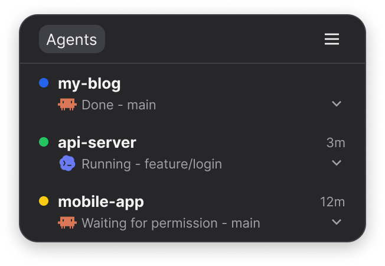
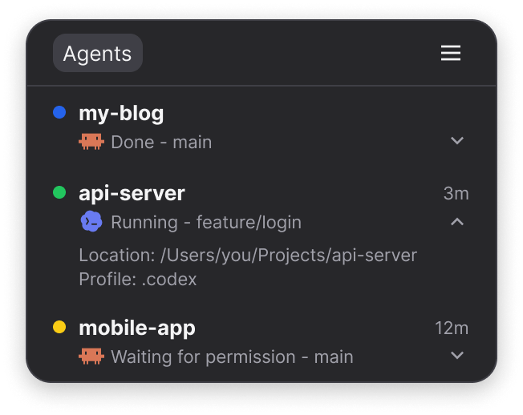
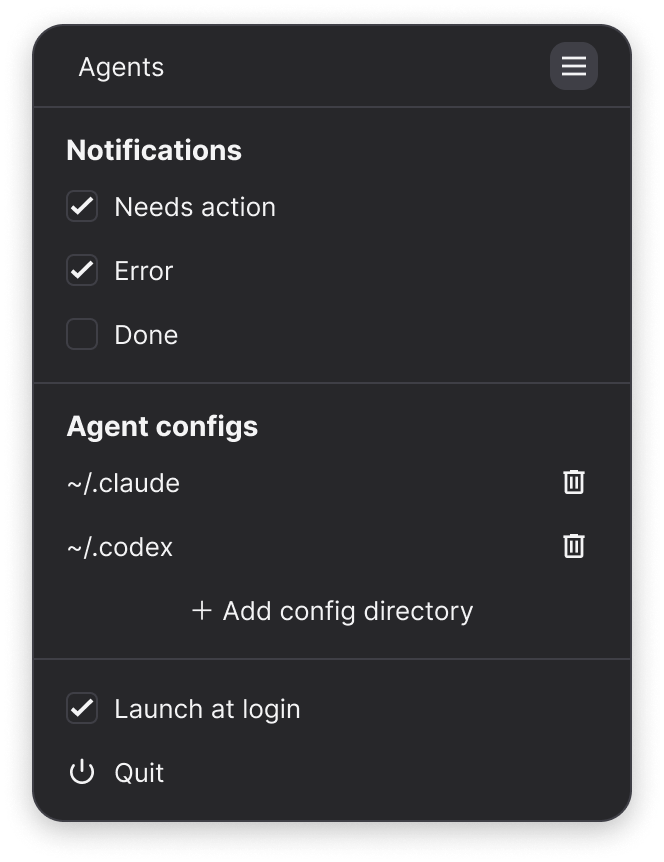

<p align="center"></p>

# Agent Loaf

[日本語](README.md)

Shows the status of the Claude Code and Codex sessions running on your Mac in the macOS menu bar, so you don't miss the ones waiting for you — a permission prompt, a question, a plan to approve.

<p align="center"></p>

## Requirements

- A Mac with Apple Silicon, macOS 14 or later (tested on macOS 26)
- Claude Code's `claude` command, or Codex (an editor extension such as VS Code, or the `codex` command). It's used to install the plugin
  - `claude` is looked up in `~/.local/bin`, `/opt/homebrew/bin`, `/usr/local/bin`, `~/.npm-global/bin`, and `~/.claude/local`
  - `codex` is looked up in `~/.local/bin`, `/opt/homebrew/bin`, `/usr/local/bin`, `~/.npm-global/bin`, and inside the Codex extension for VS Code, Cursor, and Windsurf
  - If it isn't found, enter its path on the settings page

The app follows your macOS language: Japanese if it is Japanese, English otherwise. You can change it per app in System Settings → General → Language & Region → Applications.

## Reading the status

| Color | Status | Meaning |
|---|---|---|
| Yellow | Needs action | Waiting for permission, your answer, plan approval, or input |
| Red | Error | Stopped by an API error or a usage limit |
| Blue | Done | Finished replying and waiting for your next prompt |
| Green | Running | Working |
| Gray outline | Unknown | Not monitored. Install the plugin and reopen the conversation to monitor it |

The menu bar icon is a slice of bread. A circled mark at the bottom right shows the status. When several apply, the higher row wins.

| Icon | Meaning |
|---|---|
|  | Something needs action |
|  | Something stopped with an error |
|  | Something is running |
|  | None of these |

You can drag rows to reorder them. A conversation goes back to its place when you reopen it.

A "Done" row (including "Interrupted") leaves the list once you've seen it in the list and nothing has happened for an hour. Rows you haven't seen stay until you see them. Starting a new conversation in the same window removes "New" rows where nothing was sent yet. A conversation that left the list comes back when you send to it again (without the position you dragged it to).

## Jumping to a session

Click a row to bring the screen where that session runs to the front.

- VS Code and other editors: the project's window comes to the front (the conversation tab is not selected)
- Terminals (Terminal.app, iTerm2, and others): the app comes to the front (the tab is not selected)
- Sessions running inside tmux can't be jumped to. Clicking one opens its details

Clicking a notification jumps the same way. Use the ∨ at the bottom right of a row to show its details (location and profile). Rows in the Unknown tab don't jump; clicking one opens its details.

<p align="center"></p>

## Getting the app

Download `Agent.Loaf_<version>_aarch64.dmg` from [Releases](https://github.com/imatomix/agent-loaf/releases/latest), open it, and move Agent Loaf into your Applications folder.

## Setup

1. Launch the app. If `~/.claude` or `~/.codex` exists, the plugin is installed there automatically
2. Reopen the Claude Code conversations that are already running (`claude --resume`, or open them from the conversation history in VS Code). Until then they show up as "Unknown" in the Unknown tab

On first launch, macOS asks whether to allow notifications. Allow them to be notified when a session needs action and so on.

### Trusting the Codex hooks

Codex doesn't run a plugin's hooks until you trust them. When the settings page says "Codex needs you to trust its hooks", press "Trust in Terminal". Codex opens in Terminal; trust the Agent Loaf hooks there and quit Codex. Then reload VS Code's Codex with "Developer: Reload Window".

### Other config directories

For config directories other than `~/.claude` and `~/.codex` (when you split them with `CLAUDE_CONFIG_DIR` or `CODEX_HOME`), press ≡ in the list to open the settings page, then use "＋ Add config directory" in the "Agent configs" section. A folder with a `config.toml` or an `auth.json`, or one named `.codex`, is treated as Codex; anything else as Claude Code. To remove one, press the delete icon on its row.

A red dot on the settings icon means something needs your attention: notifications are turned off, a config directory doesn't have the plugin, and so on.

### Checking that it works

Having the plugin installed doesn't guarantee the updates reach the app (the Codex hooks may not be trusted yet, for example). After setting up, try these two once:

1. Start a new conversation in Claude Code or Codex and ask for something. If it shows up in the list as "Running", the hooks are getting through
2. Ask for something that needs permission (for example, "fetch https://example.com with curl"). If it turns into "Needs action" and a notification appears, everything is working

If not, check the red dot on the settings icon, whether you trusted the Codex hooks, whether you reopened the conversation, and Agent Loaf in the notification settings of System Settings.

## Settings

Open them with ≡ in the list.

<p align="center"></p>

- Notifications: choose which statuses notify you (Needs action, Error, Done). Needs action and Error are on at first
- Agent configs: add and remove Claude Code and Codex config directories. A row without the plugin shows a Retry icon, and a Codex row whose hooks need trusting shows "Trust in Terminal". If the `claude` or `codex` command isn't found, enter its path here
- Update: shown only when a new version is available. "Update and restart" installs it and relaunches the app
- Launch at login
- Quit

## Uninstalling

1. On the settings page, remove every config directory with its delete icon (this uninstalls the plugin)
2. Turn off "Launch at login" and press "Quit"
3. Move the app to the Trash
4. Delete `~/.agent-loaf`

If you deleted the app first, run the following for each config directory (with the matching `CLAUDE_CONFIG_DIR` or `CODEX_HOME` if you split them):

- Claude Code: `claude plugin uninstall agent-loaf@agent-loaf` and `claude plugin marketplace remove agent-loaf`
- Codex: `codex plugin remove agent-loaf@agent-loaf` and `codex plugin marketplace remove agent-loaf`

## Known limitations

- Bash commands run in the background are not shown as "Background work running" (only subagents are)
- Interrupting with Esc or denying a permission turns into "Done (Interrupted)" after about 15 seconds
- Runs started with `claude -p` or from the Agent SDK aren't conversations, so they don't appear in the list and don't notify
- Events keep being recorded while the app isn't running, but recording stops after 10,000 of them (once the app starts, it reads them all and recording resumes)
- In VS Code, Claude Code and Codex don't end the previous chat when you start a new one, so it doesn't end until you close the window. Its row leaves the list by the rule under "Reading the status"
- Codex conversations without hooks (the "Unknown" rows) aren't shown
- For Codex in a terminal, clicking the row brings the terminal to the front when Codex runs with `--no-daemon`. When it uses the shared background server (the usual way to start a `codex` installed with Homebrew and the like), it may not (not yet tested)
- Runs from `codex exec` or `codex review` aren't conversations, so they don't appear in the list
- When an Agent Loaf update changes the hooks, Codex asks you to trust them again

## Data it stores

Only session status and short summaries (the running command or file name, up to 120 characters) are stored in `~/.agent-loaf/`, readable and writable only by you. Full tool inputs and file contents are never stored.

If something goes wrong inside the app, the details are kept in `~/.agent-loaf/crash.log` (up to 64 KB).

## Network

Once a day, the app checks GitHub for a new version (it only reads `latest.json`). It doesn't connect anywhere else.

## Development

You need Rust and Node.js. To build from source (without update artifacts; the build doesn't check for updates):

```bash
./scripts/build-hook-sidecar.sh
cd app && npm install && npm run tauri build -- --config '{"bundle":{"createUpdaterArtifacts":false}}'
```

Move the resulting `target/release/bundle/macos/Agent Loaf.app` into your Applications folder.

```bash
./scripts/dev-install-hook.sh      # put the hook in ~/.agent-loaf/bin
./scripts/build-hook-sidecar.sh    # build the hook bundled with the app
./scripts/integration-test.sh      # integration test with the real claude
cargo test --workspace
cd app && npm install && npm run tauri dev
```

- Run `./scripts/build-hook-sidecar.sh` before `npm run tauri dev` (the app can't be built without the bundled hook)
- Notifications don't appear under `tauri dev` (it doesn't run as an app bundle)
- Running Claude Code with the `AGENT_LOAF_DEBUG_RAW` environment variable makes the hook save the full input it receives to `~/.agent-loaf/raw`. It's meant for debugging; delete it when you're done

Release steps (Japanese): `docs/releasing.md`. Design docs (Japanese): `docs/superpowers/specs/`

## License

MIT

## Trademarks

Claude Code is a trademark of Anthropic, and Codex is a trademark of OpenAI. The marks shown in the app belong to their respective owners. Agent Loaf is a personal project and is not affiliated with or endorsed by Anthropic or OpenAI.
