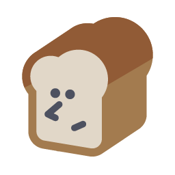
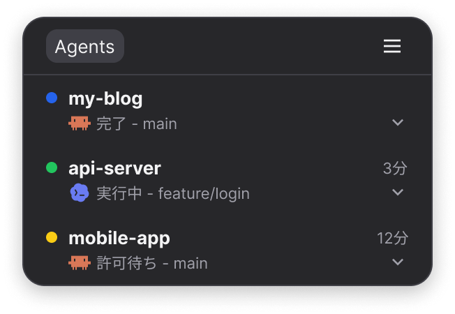
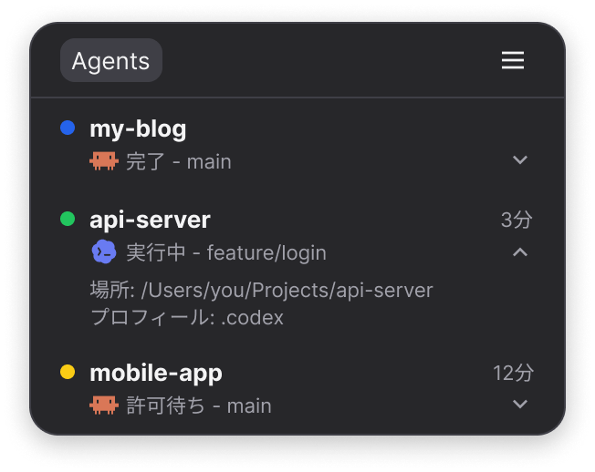
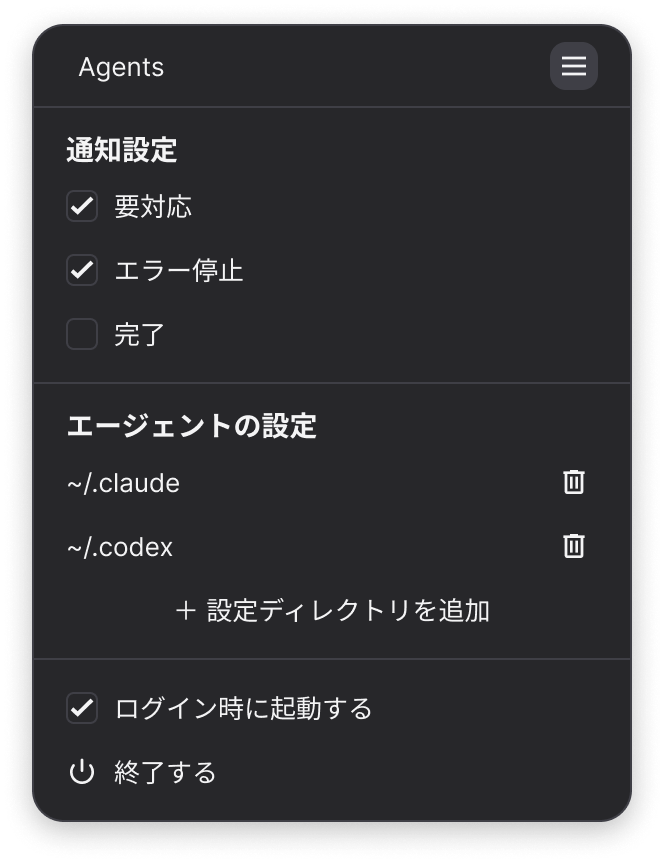

<p align="center"></p>

# Agent Loaf

[English](README.en.md)

マシン上で動いている Claude Code と Codex のセッションの状態を、macOS のメニューバーに一覧表示します。許可待ちや質問待ちなど、あなたの対応が必要なセッションを見落とさないためのツールです。

<p align="center"></p>

## 必要な環境

- Apple Silicon の Mac、macOS 14 以降（確かめたのは macOS 26）
- Claude Code の `claude` コマンド、または Codex（VS Code などの拡張か `codex` コマンド）。プラグインを入れるのに使います
  - `claude` は `~/.local/bin`・`/opt/homebrew/bin`・`/usr/local/bin`・`~/.npm-global/bin`・`~/.claude/local` を探します
  - `codex` は `~/.local/bin`・`/opt/homebrew/bin`・`/usr/local/bin`・`~/.npm-global/bin` と、VS Code・Cursor・Windsurf の Codex の拡張の中を探します
  - 見つからなければ、設定の画面で場所を入力します

表示は macOS の言語に合わせて、日本語か英語になります。アプリごとに変えたいときは、システム設定 → 一般 → 言語と地域 → アプリケーション で選んでください。

## 状態の見方

| 色 | 状態 | 意味 |
|---|---|---|
| 黄 | 要対応 | 許可待ち・質問待ち・承認待ち・入力要求 |
| 赤 | エラー停止 | API エラーや利用上限で止まった |
| 青 | 完了 | 応答が終わり、次の指示を待っている |
| 緑 | 実行中 | 作業中 |
| グレーの枠 | 状態不明 | 監視対象外のセッション。プラグインを入れてから会話を開き直すと監視される |

メニューバーのアイコンは食パンの形で、右下の丸囲みの記号で状態を示します。複数あるときは、上の行ほど優先します。

| アイコン | 意味 |
|---|---|
|  | 要対応のセッションがある |
|  | エラー停止したセッションがある |
|  | 実行中のセッションがある |
|  | どれもない |

一覧の行はドラッグで並び替えられます。会話を開き直しても元の位置に戻ります。

「完了」の行（「中断」を含む）は、一覧で見たあと 1 時間何も起きなければ一覧から消えます。見ていない行は、見るまで残ります。同じウィンドウで新しい会話を始めると、まだ何も送っていない「新規」の行は消えます。消えた会話も、また送れば一覧に戻ります（並び替えた位置は戻りません）。

## 画面移動

一覧の行を押すと、そのセッションが動いている画面が前面に出ます。

- VS Code などのエディター: そのプロジェクトのウィンドウが前面に出ます（会話のタブは選びません）
- ターミナル（Terminal.app・iTerm2 など）: そのアプリが前面に出ます（タブは選びません）
- tmux の中で動くセッションは移動できません。押すと詳細が開きます

通知を押しても、同じように移動します。詳細（場所・プロフィール）は、行の右下の ∨ で開きます。Unknown タブの行は移動せず、押すと詳細が開きます。

<p align="center"></p>

## 入手

[Releases](https://github.com/imatomix/agent-loaf/releases/latest) から `Agent Loaf_<版>_aarch64.dmg` をダウンロードして開き、Agent Loaf を「アプリケーション」フォルダーに入れてください。

## 導入

1. アプリを起動する。`~/.claude` や `~/.codex` があれば、プラグインが自動で入ります
2. 動いている Claude Code の会話を開き直す（`claude --resume` や、VS Code の会話の履歴から開く）。開き直すまでは Unknown タブに「状態不明」として出ます

初めて起動すると、macOS が通知の許可を尋ねます。許可すると、対応が必要になったときなどに通知が届きます。

### Codex の hook の許可

Codex は、プラグインの hook を利用者が許可するまで動かしません。設定の画面に「Codex の hook の許可が必要です」と出たら、「ターミナルで許可する」を押してください。ターミナルで Codex が開くので、Agent Loaf の hook を許可してから Codex を終えます。その後、VS Code の Codex は「Developer: Reload Window」で読み込み直してください。

### ほかの設定ディレクトリ

`~/.claude`・`~/.codex` 以外の設定ディレクトリ（`CLAUDE_CONFIG_DIR` や `CODEX_HOME` で分けている場合）は、一覧の ≡ を押して設定の画面を開き、「エージェントの設定」の欄の「＋ 設定ディレクトリを追加」で選んでください。`config.toml` か `auth.json` があるフォルダーと、名前が `.codex` のフォルダーは Codex、それ以外は Claude Code として扱います。外したいときは、その行の削除のアイコンを押します。

設定アイコンに赤い丸が付いているときは、通知がオフになっている、プラグインが入っていない設定ディレクトリがある、などの確認が必要な状態です。

### 動作を確かめる

プラグインが入っていても、知らせが届くとは限りません（Codex の hook の許可がまだ、など）。導入したら、一度次の 2 つを試してください。

1. Claude Code か Codex で新しい会話を始めて、何か頼む。一覧にその会話が「実行中」で出れば、hook が届いています
2. 許可が要る操作を頼む（例: 「curl で https://example.com を取ってきて」）。「要対応」になり、通知が出れば、知らせまで届いています

出ないときは、設定アイコンの赤い丸、Codex の hook の許可、会話を開き直したか、システム設定の通知（Agent Loaf）を確かめてください。

## 設定

一覧の ≡ で開きます。

<p align="center"></p>

- 通知設定: 通知する状態（要対応・エラー停止・完了）を選びます。はじめは要対応とエラー停止です
- エージェントの設定: Claude Code と Codex の設定ディレクトリの追加と削除。プラグインが入っていない行には「もう一度」のアイコン、Codex の hook の許可が要る行には「ターミナルで許可する」が出ます。`claude` や `codex` のコマンドが見つからないときは、ここで場所を入力します
- アップデート: 新しい版があるときだけ出ます。「アップデートして再起動」で入れ替えて起動し直します
- ログイン時に起動する
- 終了する

## 消し方

1. 設定の画面で、すべての設定ディレクトリを削除のアイコンで外す（プラグインが外れます）
2. 「ログイン時に起動する」を外し、「終了する」で終わる
3. アプリをゴミ箱に入れる
4. `~/.agent-loaf` を消す

アプリを先に消した場合は、設定ディレクトリごとに次を実行してください（`CLAUDE_CONFIG_DIR` や `CODEX_HOME` で分けているときは、それぞれの値を付けて実行します）。

- Claude Code: `claude plugin uninstall agent-loaf@agent-loaf` と `claude plugin marketplace remove agent-loaf`
- Codex: `codex plugin remove agent-loaf@agent-loaf` と `codex plugin marketplace remove agent-loaf`

## 既知の制約

- バックグラウンドで実行した Bash コマンドは「バックグラウンド作業あり」と表示されません（サブエージェントのみ表示）
- Esc での中断や許可の拒否は、約 15 秒後に「完了（中断）」に変わります
- `claude -p` や Agent SDK から動かした実行は、会話ではないので一覧に出さず、通知もしません
- アプリが止まっている間も記録は溜まりますが、10,000 件を超えると、それ以降は記録しません（アプリを起動すると読み取って空になり、また記録します）
- VS Code の Claude Code と Codex は、新しいチャットを始めても前のチャットを終えず、ウィンドウを閉じるまで終了の知らせが来ません。前のチャットの行は、上の「状態の見方」の決まりで一覧から消えます
- Codex では、hook が届いていない会話（Unknown タブの「状態不明」）を出しません
- ターミナルの Codex は、`--no-daemon` で起動したものは行を押すとターミナルが前に出ます。裏の共通のサーバーを使う起動（Homebrew などで入れた `codex` の普通の起動）では、移動できないことがあります（確かめていません）
- `codex exec` や `codex review` からの実行は、会話ではないので一覧に出しません
- Agent Loaf の版が上がって hook の中身が変わったときは、Codex でもう一度許可が要ります

## 保存するデータ

`~/.agent-loaf/`（本人だけが読み書きできる権限）に、セッションの状態と短い要約（実行中のコマンドやファイル名、最大 120 文字）だけを保存します。ツールへの入力の全文やファイルの中身は保存しません。

アプリの中で異常が起きたときは、その内容を `~/.agent-loaf/crash.log`（64KB まで）に残します。

## 通信

1 日に 1 回、GitHub に新しい版を確かめに行きます（`latest.json` を読むだけです）。ほかには通信しません。

## 開発

Rust と Node.js が要ります。ソースから作るときは次のようにします（自動更新の成果物は作らず、更新も確かめに行きません）。

```bash
./scripts/build-hook-sidecar.sh
cd app && npm install && npm run tauri build -- --config '{"bundle":{"createUpdaterArtifacts":false}}'
```

できた `target/release/bundle/macos/Agent Loaf.app` を「アプリケーション」フォルダーに入れてください。

```bash
./scripts/dev-install-hook.sh      # hook を ~/.agent-loaf/bin に置く
./scripts/build-hook-sidecar.sh    # アプリ同梱用の hook を作る
./scripts/integration-test.sh      # 本物の claude を使う結合テスト
cargo test --workspace
cd app && npm install && npm run tauri dev
```

- `npm run tauri dev` の前に `./scripts/build-hook-sidecar.sh` が要ります（アプリに同梱する hook がないと作れません）
- `tauri dev` では通知が出ません（アプリとして起動していないため）
- 環境変数 `AGENT_LOAF_DEBUG_RAW` を付けて Claude Code を動かすと、hook が受け取った入力の全文を `~/.agent-loaf/raw` に保存します。調べもの用なので、使い終わったら消してください

公開の手順: `docs/releasing.md`　設計: `docs/superpowers/specs/`

## ライセンス

MIT
